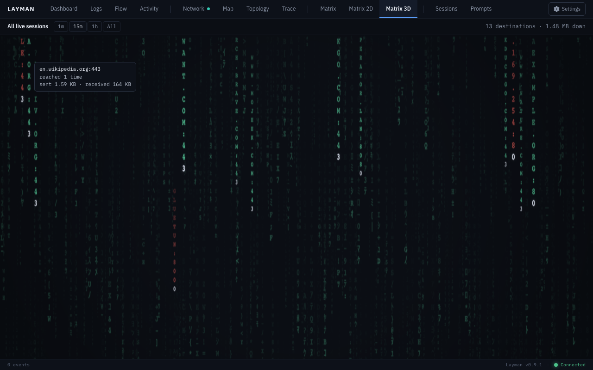
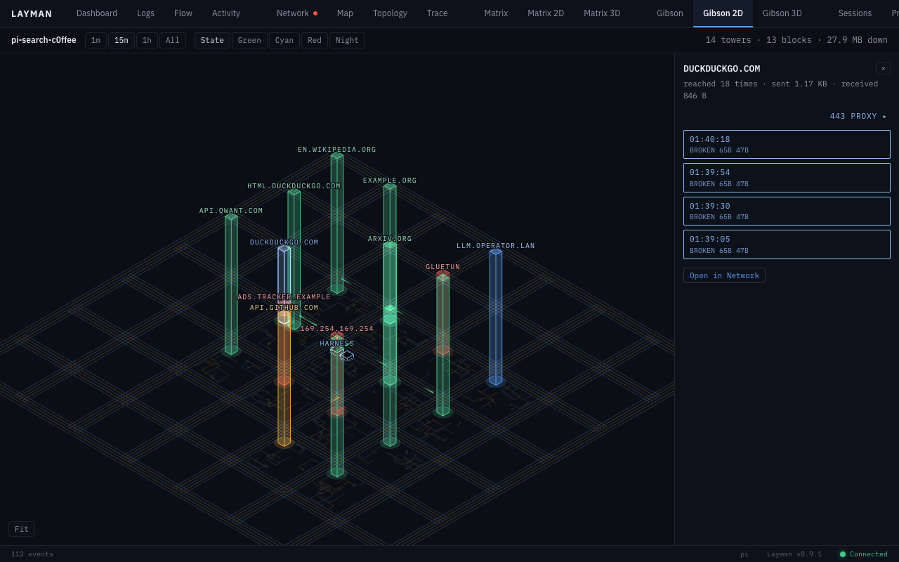
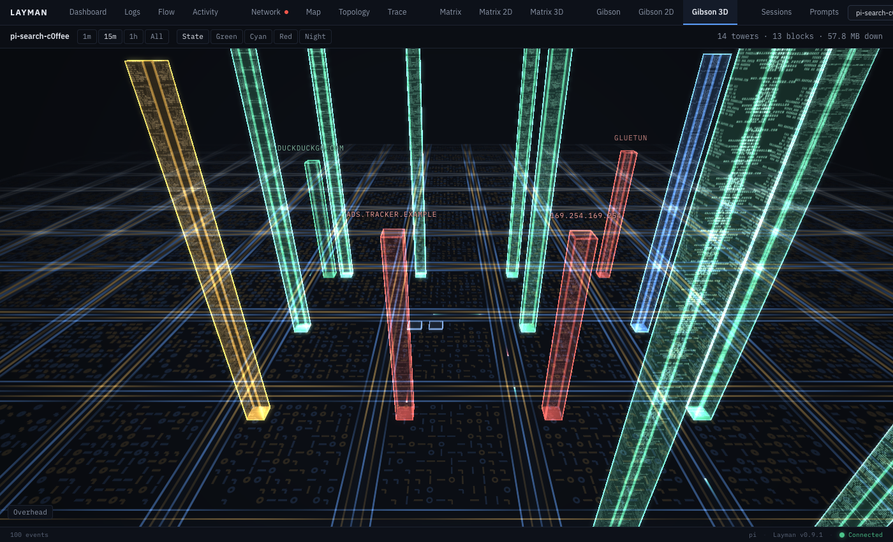

# Styx

[Styx](https://github.com/Jigsaw-Studio/styx-godot) began as a Raspberry Pi WiFi access point that records
the traffic passing through it, and a [Godot](https://godotengine.org) app that draws it. Its best-known
view is the **Matrix**: green glyph rain with the domain names being accessed falling through it.

Layman's Styx extension draws the same picture for what an AI coding agent reached, and serves the data
in the shape styx-godot already reads, so that app can be pointed at Layman as well as at a Pi. It is
optional, off by default, and independent of glove: with it off there are no tabs and `/api/styx/` answers
404.

## Turning it on

**Settings → Extensions → Styx → Matrix views.** The setting is `styx.enabled` in
`~/.local/share/layman/layman.json`. `styx.godotDir` is the folder holding the Matrix (Godot) tab's build (below); leave it empty for the default.

## The tabs

| Tab | URL | What it is | Status |
|---|---|---|---|
| **Matrix** | `?view=matrix` | The real styx-godot web export, running its own shaders, in an iframe | available (needs a local build) |
| **Matrix 2D** | `?view=matrix2d` | Layman's own Canvas 2D rendering. No Godot | available |
| **Matrix 3D** | `?view=matrix3d` | Layman's own WebGL2 rendering. No Godot | available |
| **Gibson** | `?view=gibson` | The styx-godot city in a frame | coming |
| **Gibson 2D** | `?view=gibson2d` (`G`) | A city of towers, one per host, drawn on a canvas. No Godot | available |
| **Gibson 3D** | `?view=gibson3d` | The same city in WebGL2, which you fly through | available |

All six are session views (`/s/<id>?view=matrix2d`) and show the session open in the app, or else the
newest live one; with none they show every live session together.

**Matrix 2D.** A full-area canvas of monospace columns. Every column carries faint, slow filler rain.
Each destination falls as its own stream: its address in upper case, one character per row, the lowest
character brightest and the ones above fading out. A busier destination falls faster and comes back
sooner. A destination glove refused falls in the error colour, one that did not go through the tunnel in
the warning colour. A host reached for the first time falls at once, with a bright head, for that one
fall. A window picker (`1m`, `15m`, `1h`, `All`, remembered in the browser) chooses how far back to look; with
no session open, `All` means the last day, the longest the feed answers for every live session together. Hover
a stream for its address, count and bytes; click it to keep the card, which for a sandboxed session offers
**Open in Network**. The tab's shortcut is `X`. With Settings → Motion at Reduced or Off, it draws one still
frame instead of falling.



**Matrix 3D.** The same destinations, drawn on the GPU in a browser with WebGL2, as four planes of rain at
different depths: the far two are filler only, smaller, dimmer and slower, and slide against the near two as
the view drifts slowly sideways. The destinations fall on the near two planes, the most reached half on the
nearest, a new host always on the nearest. Heads glow (a light theme has none), with a soft vignette. Larger
glyphs, one stream per column reading top to bottom, the head near white, a refused destination red, one that did not go
through the tunnel amber, a host reached for the first time in the accent colour for its first fall, and
faint filler rain behind them. It follows the window picker, the session, the theme (a light theme draws
dark glyphs on the light ground) and Settings → Motion exactly as Matrix 2D does, and hover and click give
the same card. A browser without WebGL2 shows a message and a button to Matrix 2D.

**Matrix (Godot).** The frame shows styx-godot's own scene, shaders included, for the session and window
chosen in the bar. It reads the same feed, asking every two seconds for hosts it is not showing yet, so a
new one falls at once without the rest restarting. Changing the session or window reloads the engine (after
half a second, so stepping through sessions does not restart it for each); leaving the tab removes the
frame, which stops it. Instead of the frame the tab says why it cannot run: no build found (with the
folder it looked in and what is missing), Motion at Reduced or Off (**Run anyway** starts it), or a page
that is not a secure context.



**Gibson 2D.** The destinations as a city, seen from above at an angle, in the style of the film's
network view. Each host is a **tower** on a board of thin circuit traces. Towers stand in **blocks**: one
block for each registrable domain (an IPv4 address's /16 for a bare address), so `api.github.com` and
`github.com` are neighbours; a block holds 16 towers, then a second block opens. The busiest domains stand
nearest the middle. A tower's **height** is the bytes it moved and its **width** the times it was
reached, both on a log scale against the busiest on screen. Who stands where is remembered while the tab is
open, so a refresh adds and removes towers and never reshuffles the city; a new host is drawn bright and
**rises** into place in about a second, and a host that left the answer frees its plot. The **chips** in the middle block are the
machine itself: one for each source of a connection (the harness, the agent, a device), or a single one called
`LOCAL` when a session has no connections to draw, such as one whose tool calls were only recorded. A **streak** crossing the streets is a connection going out
or coming back along the streets between its chip and its tower; a busier link sends more of them; one
glove refused flashes where it stops.

The look is chosen with the scheme picker (remembered in the browser). **State** colours by what the
destination is and follows the theme (light themes included): green is normal, red a tower every connection
of which glove refused (and a partial red cap for a part), amber one that did not go through the tunnel,
and the theme's accent colour (blue in Classic) a local or LAN one; a selected tower uses the highlight colour. **Green**, **Cyan**, **Red** and **Night**
are fixed looks after the film's stills that ignore the theme (they always draw on a dark board); in these
the state is shown by marks instead of colour: a refused tower is striped, an untunnelled one has dashed
edges. Night draws lit windows and dotted streets. The window picker works as in the Matrix.

**Drag** pans, the **wheel** zooms about the pointer, the arrow keys and `+` / `-` do both from the keyboard,
and **Fit** brings the whole city back. The camera is yours once you move it, until you change the session or
window or press Fit. The busiest 12 hosts are labelled, and every one once you are close enough to read;
at that zoom the faces of a tower carry its facts as small text. **Hover** a tower for its address,
count and bytes; **click** it to open its panel on the right: the tower's log, grouped into the menu's
items (`PORT VIA ▸`, up to 12), and under the picked item up to four boxes for its recent connections or
calls, a refused one in red, each with its time, state and bytes. The picked tower's faces continue with its
last log lines. For a sandboxed session the panel offers **Open in Network**. **Escape** closes it. With
Settings → Motion at Reduced or Off nothing moves: towers do not rise, and each active route is drawn as a
dashed line instead of streaks. A screen reader gets a list of the hosts, their counts and their state in words.
The tab's shortcut is `G`.



**Gibson 3D.** The same city (the same towers, blocks, chips, streaks, schemes, window picker, hover card and
panel) in perspective, drawn with raw WebGL2, and a camera you fly. It starts high over the home block looking
down at 45°. Beyond what the 2D tab shows: a **sky** (indigo, drifting violet filaments, gold arcs, soft clusters
of symbols, pale streaks) that turns with you and hazes into the board at the horizon; **glass** towers that you
see through each other, with a soft glow on the board under each; the **faces** of every tower carry its page
as real text, readable up close and fading into rows of bars at a distance (Night's become lit windows); the
host's name over each of the busiest 12 towers and every one near you; and a **glow** on everything bright.

**Drag** looks around, the **wheel** moves along the view, and with the canvas focused `W` `A` `S` `D` (or the
arrows) fly, `Q` and `E` go down and up, and Shift is three times faster. While the canvas has focus these
keys fly instead of using the header's shortcuts (`A`, `S`, `D`); click outside it and they work again.
**Hover** a tower for its card; **click** one to fly to where its face can be read (a camera 9 units off, at
eye height) and open its panel, whose log lines also continue on the tower's own faces. **Overhead** flies
back. After 20 seconds without input, with nothing selected and Motion at Full, the camera tours: down
onto a street between the towers, along it, up and round again; any input ends the tour where it is. With Motion
at Reduced or Off there is no tour, nothing moves, routes are dashed lines, and a selection jumps instead of
flying. A browser without WebGL2, or a GPU that cannot start it, shows a message and a button to Gibson 2D. A
light theme in State draws the glass by cover instead of light, with no glow; the film schemes always draw on
their dark board. Nothing leaves Layman: the sky, the text and the board are all drawn from what the page already
holds.

### Building the Godot tab

Layman does not ship styx-godot; you make the web export and Layman serves the folder.

```bash
make styx-godot-build
```

This exports styx-godot's **Web (Layman)** preset into Layman's data folder
(`~/.local/share/layman/styx/godot`, or under `$LAYMAN_DATA_DIR` / `$XDG_DATA_HOME`). Variables:
`STYX_GODOT` (the styx-godot checkout, default `../../jigsaw/styx-godot`), `GODOT` (the Godot 4.3 binary,
default `~/Applications/Godot_v4.3.app/Contents/MacOS/Godot`) and `STYX_GODOT_OUT`. Godot must have
imported the project once and have the export templates for its version installed: styx-godot's README
describes both. The old **Web** preset loads scripts from a CDN and is refused by the policy below; Settings
shows "This build loads scripts from another site" for such a build.

**Where it lives.** `styx.godotDir` (Settings → Extensions → Styx → Godot build folder), empty for the
default above. A configured folder is only read, never created. A Layman running in Docker sees only the
default location, which is inside the data folder it already mounts.

**The policy.** Layman serves the build under `/styx/godot/` (404 while Styx is off) with a
Content-Security-Policy whose `connect-src 'self'` and `default-src 'self'` mean the page can talk to Layman
and nothing else, so "every request goes to Layman" is enforced, not hoped for. That is a limit on where
the page can send things, not a sandbox: it runs on Layman's origin and can call Layman's own API like any
Layman page, so build it yourself and point the folder only at a build you trust. Godot's shell needs inline
scripts and styles and `eval`, so those directives carry `unsafe-*`, for these responses only. A request
path can only name a file inside the folder (a symlink leading out is refused), of a known type, with no
dotfile or `..` in it. A build that loads scripts from another site is reported as no build, because the
policy would block it.

**Secure page.** Godot's web shell refuses to start outside a secure context. `http://localhost:8880` and
`http://127.0.0.1:8880` are; Layman opened over the LAN by IP address, or over plain http from another
host, is not, and the tab says so (Matrix 2D and 3D work there).

## The feed

`GET /api/styx/v1/matrix` has the shape of styx-os's `GET /v1/matrix` (its nginx exposes it as
`/api/v1/matrix`), plus optional fields styx-godot ignores. Layman serves it itself: the Pi's API reads
the Pi's packet database, and this is a second, independent source of the same shape.

| Query | Meaning |
|---|---|
| `relative` | Styx's own: a window ending now, `<integer><unit>`, unit `s`, `m`, `h` or `d` (`60s`, `15m`, `1h`). Absent: the whole record of the selected session. With no selector and no `relative`, the window is `15m`. |
| `session` | A Layman session id. If that session is gloved, the answer is its glove session's flows. |
| `glove` | A glove session id (the token the network views use). |

`session` and `glove` together: 400. Any of Styx's absolute-time parameters (`start_date`, `start_time`,
`end_date`, `end_time`, `timezone`, `client`): 400 with `{ "error": "… is not supported by Layman's Styx
feed" }`. A malformed `relative`: 400. An unknown `session` or `glove`: 404. Styx off: 404 for the whole
`/api/styx/` prefix.

The answer is a JSON array, highest `count` first, ties by `address` ascending, at most 256 rows:

```json
[
  { "address": "api.github.com:443", "sent": 5120, "received": 88211, "count": 14,
    "blocked": 0, "untunnelled": false }
]
```

| Field | Meaning |
|---|---|
| `address` | `host:port`, lower-case. For a standard session a URL with no port gets its scheme's (`:443` for https, `:80` for http), so the port tells which was used; `host` alone only for a target with no URL (an ssh host). |
| `sent`, `received` | Bytes up and down. 0 for a standard session. |
| `count` | How many times it was reached: flows for a gloved session, tool calls naming it for a standard one. Always at least 1. |
| `blocked` | Layman addition: how many of those glove refused. 0 for a standard session. |
| `untunnelled` | Layman addition: true when glove classed the traffic `direct` and it is not a known VPN route. false for a standard session. |

styx-godot reads only `address` and `count`.

## The Gibson feed

Three more routes, for the Gibson views, with the shape of styx-os's `GET /v1/hosts`, `/v1/links` and
`/v1/flows` (through its nginx, `/api/v1/…`). The Pi answers them from its packet database; Layman answers
them from its own records, so a view reads either source the same way. `/api/styx/v1/matrix` is unchanged.

```
GET /api/styx/v1/hosts     one row per remote host: a tower
GET /api/styx/v1/links     one row per (source, via, target): the traffic
GET /api/styx/v1/flows     the log, newest first: a tower's menu
```

`session`, `glove` and `relative` mean what they mean for the matrix, and so do the errors: the selection is one
piece of code for all four routes. `/flows` also takes `host` (one lower-case host, no port) and `limit` (1 to
500, default 100; anything else is 400). Every answer is a JSON array of flat objects with snake_case names; a
field Layman cannot know has a neutral value (`0`, `""`, `[]`, `null`), never a missing key.

```json
[
  { "host": "api.github.com", "block": "github.com", "ports": [443], "sent": 5120, "received": 88211,
    "count": 14, "open": 1, "blocked": 0, "untunnelled": false, "scope": "tunnelled",
    "first_seen_ago": 840, "last_seen_ago": 3,
    "clients": ["harness"], "tools": ["web_fetch"], "services": ["proxy"] }
]
```

**Hosts** (highest `count` first, ties by `host`, at most 256). The ports of one host are one row.

| Field | Gloved session | Standard session |
|---|---|---|
| `host` | `dest.host`, else its IP, lower-case | the host a tool call named |
| `block` | the city block: an IPv4's /16 (`165.1.0.0/16`), an IPv6 literal itself, else the registrable domain (`wikipedia.org`, from the offline Public Suffix List) | the same |
| `ports` | the distinct ports, at most 16 | its URL's port, else its scheme's; `[]` when unknown |
| `sent`, `received` | bytes up and down | 0 |
| `count` | connections | tool calls naming it |
| `open` | connections open now | calls still running |
| `blocked` | connections glove refused | 0 |
| `untunnelled` | glove's `direct` and not a known VPN route | false |
| `scope` | glove's (`tunnelled`, `local`, `direct`, `lan`, `cloud`) | `""` |
| `first_seen_ago`, `last_seen_ago` | whole seconds from the first and the latest activity to now | from the calls' start times |
| `clients`, `tools`, `services` | the distinct values, sorted, at most 8 each | `[]`, the tool names, `[]` |

**Links** (highest `count` first, then `source`, `via`, `target`; at most 512): `source`, `source_kind`,
`via`, `target`, and the same `sent`, `received`, `count`, `open`, `blocked`, `last_seen_ago` for that triple.
Gloved: `source` is the glove client (`harness` when it has none), `source_kind` `client`, `via` the gate
the connection left through. Standard: `source` and `source_kind` are `agent` and `via` is the tool.

**The log**: `host`, `time` (epoch seconds), `ago`, `source`, `via`, `tool`, `port`, `proto`, `sent`,
`received`, `state`, `blocked`, `rule`, `method`, `url`, `label`. A gloved row is one connection: `state` is
glove's (`active`, `pooled`, `finished`, `guard`, `user_rule`, `default_block`, `broken`, …) and `blocked` is
true for the three refusals. A standard row is one tool call: `active` while it runs, `broken` if it failed,
else `finished`, with `label` always null (a call's label is content: a query, a command, a URL).

Links and the log are always computed from the connections Layman still holds in memory, also for the whole
record, because glove's running totals do not say which client reached which host. They reach back only as
far as that memory does; the hosts of a whole-record answer do not (they are the totals). A hop is not a
destination here either.

The answer is cheap enough to poll every two seconds, as the matrix is: gloved rows come from memory, and a
standard session's from the in-memory events, reading its recording only for a window that reaches before
memory begins (cached 30 s). Privacy is unchanged: no lookup of a host, no network call. A request's `url`
and `method` appear in the log only when glove recorded them in full, exactly as its PII filter left them.

## What the data is

- **A gloved session** (a Layman session whose name is a glove session id that Layman has network records
  for) uses glove's full flow data: bytes, counts, refusals. With a window, it is the flows in that
  window; without one, glove's running totals per destination, which survive the memory limit on old
  flows. A window reaches back only as far as the flows Layman still holds in memory, which is right for
  a recent window.
- **A standard session** uses the hosts its tool calls named (a `WebFetch` URL, a `curl` in a shell
  command), counted once per call. Bytes are 0. Traffic that no tool call named does not appear.
- **With no selector**, every live gloved session and every live standard session, merged.
- **A hop is not a destination.** A sandbox's local link to a sidecar (the llm-auth hop, say) is left out,
  as in the network views: its bytes are counted at the next leg.
- **Freshness.** A windowed answer for a standard session comes from the events Layman holds in memory, so
  a host a tool call names shows at once. The whole record of a standard session is reused for 5 s, so a
  new host can take that long to appear under **All**.

## Privacy

- Layman reads only its own records. The feed never makes a network call keyed on what it shows, and it
  never looks a host up (no DNS, no geolocation, no reputation service).
- Hosts are shown as recorded. For a standard session they come from events that went through the PII
  filter, so an IP address the filter redacted is not shown.
- Nothing here is synced between hosts, and the extension adds no table: the feed is computed on request.

## Licences

Layman is MIT. In styx-godot, the domain shader is the author's own (MIT), but its background and 3D rain
shaders are Shadertoy ports under CC BY-NC-SA 3.0. Layman's 2D and 3D renderers are therefore written from
scratch and share no code with any styx-godot shader. The Matrix (Godot) tab runs a build of styx-godot
that the user makes locally; Layman never ships it.
